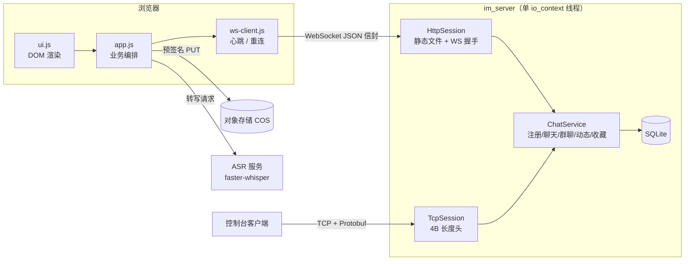
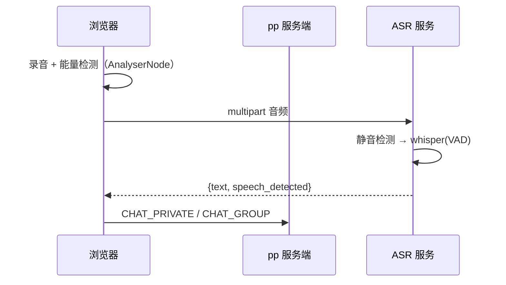

<div align="center">

# pp · 网页版即时通讯

**一个进程搞定 HTTP + WebSocket + 原始 TCP 的微信风格 IM**

C++17 / 独立 Asio / Protobuf / SQLite / 原生 JavaScript


**在线体验** · [pp.xiaojietong.online](https://pp.xiaojietong.online)

</div>

---

## 这是什么

`pp` 是一个**从零手写**的网页即时通讯项目，不依赖任何现成 IM 框架：

- 服务端是一个单线程 Reactor，用 **standalone Asio** 自己实现 HTTP/1.1 静态服务、
  **RFC 6455 WebSocket** 握手与帧编解码，以及带 4 字节长度头的原始 TCP 链路；
- 三条链路共用**同一份 Protobuf 协议**，浏览器侧通过 `WebEnvelope{type, body}` +
  proto3 JSON 转换，前端因此**不需要 protobuf 运行时**；
- 前端是**无框架的原生 JS**（约 6k 行），从登录、聊天、群聊到朋友圈、收藏夹全部手写；
- 富媒体不经过服务器：图片 / 文件 / 语音均由浏览器**直传对象存储**，
  服务端只签发 10 分钟有效的预签名票据。

> 目标不是造一个能跑 demo，而是把「一个能真正用起来的 IM 需要什么」完整走一遍：
> 协议设计、连接生命周期、离线历史、未读位点、富媒体、消息交互、部署与运维。

---

## 功能

### 账号与会话

| 能力 | 说明 |
|---|---|
| 注册 / 登录 | 支持**用户名或 pp 号**登录，密码加盐 SHA-256，同账号顶号 |
| pp 号 | 注册自动生成 `pp100001` 形式，可自定义 4~20 位 |
| 免登录恢复 | `localStorage` 长期令牌，刷新页面静默恢复，不必重登 |
| 个人资料 | 昵称、签名、pp 号、**头像上传**（浏览器压到 400px 后 COS 直传） |
| 二维码 | 浏览器端本地生成，扫码 `?u=<pp号>` 直接加好友，服务端零开销 |
| 授权管理 | 第三方应用授权列表与解绑（OAuth 2.0 授权码 + PKCE 流程） |

### 聊天

| 能力 | 说明 |
|---|---|
| 私聊 | 仅好友可聊、历史分页、发送回执、失败标记、正在输入、90 秒空闲断线 |
| 群聊 | 创建、邀请好友、成员列表（群主 / 在线态）、退出与解散、系统消息 |
| 富媒体 | 图片、文件、**语音条**（微信式宽度随时长变化） |
| 语音转文字 | 按住说话上滑转文字，复用同一份 faster-whisper 服务 |
| 会话列表 | 私聊 + 群聊混排、最后一条内容、未读红点、群消息显示发送者 |
| 实时性 | WebSocket 心跳、指数退避重连、断线恢复后拉取历史 |

### 消息交互（对齐微信）

| 能力 | 说明 |
|---|---|
| 长按 / 右键菜单 | 复制、引用、收藏、撤回、添加到表情、打开文件 |
| 引用回复 | 气泡顶部渲染引用块，协议带 `quote_id/text/nickname` |
| 撤回 | 自己发的消息、**2 分钟内**，服务端清空正文并双向推送 |
| 拍一拍 | **双击对方头像**，落成一条 `msg_kind=4` 的消息，**同样可撤回** |
| 收藏夹 | 独立侧栏视图，服务器持久化，支持转发到任意会话 |
| 自定义表情 | 长按图片「添加到表情」，表情面板双 tab（表情 / 收藏的表情） |
| 时间分隔 | 跨天显示日期，同一天内间隔 ≥ 2 分钟才插入时间行 |
| 输入栏 | 微信式 `+ / 麦克风 / 输入框 / 表情 / 发送`，面板从底部滑出 |

### 动态（朋友圈）

发帖（文字 + 最多 9 图）、好友时间线、点赞、评论、删除自己的动态；
新动态推送给好友，点赞 / 评论实时通知作者。

---

## 技术栈

| 层 | 选型 | 说明 |
|---|---|---|
| 语言 | C++17 | 服务端与共用层 |
| 网络 | standalone Asio | 自己实现 HTTP / WebSocket / TCP，不引 Beast |
| 协议 | Protobuf 3 | 单份 `.proto` 三端共用 |
| 存储 | SQLite 3 | 同步访问，单线程量级足够；启动自动迁移 |
| 日志 | spdlog + fmt | 结构化日志 |
| 构建 | CMake Presets + vcpkg manifest | Windows / Linux 双预设 |
| 前端 | 原生 HTML / CSS / JS | 无框架、无打包器 |
| 富媒体 | 腾讯云 COS | 预签名直传，文件不经过服务器 |
| 语音 | faster-whisper | 独立进程 + VAD + 能量检测 |
| 部署 | Caddy + systemd | 自动 HTTPS |

---

## 架构



**关键设计**

1. **传输与业务解耦** —— `Peer` 抽象只暴露 `sendProto(MsgType, Message)`，
   业务层不知道对端是 WebSocket 还是原始 TCP。
2. **两条链路同一份协议** —— 内层消息全部来自 `proto/im_msg.proto`，
   新增功能只改一处协议。
3. **WebSocket 用 JSON** —— `body` 是内层消息的 proto3 JSON，由 `libprotobuf`
   的 `json_util` 双向转换；新增客户端消息类型必须同时在
   `msg_type.hpp`、`json_codec.cpp::toBinary()`、`chat_service.cpp::onPacket()`
   三处登记，漏一处会返回 400。
4. **单线程 Reactor** —— `io_context.run()` 驱动 accept / read / write，
   业务与存储都在同一线程，没有锁，也没有跨线程回调。
5. **直传而非中转** —— 服务端只签发 10 分钟有效的预签名 PUT URL，
   文件字节完全绕开这台服务器，2C2G 也能扛。

---

## 快速开始

### 环境要求

- CMake ≥ 3.20、C++17 编译器（MSVC 2022 / GCC 11+）
- vcpkg（manifest 模式，依赖自动安装）

### Windows

```powershell
git clone https://github.com/asuperj1/ppIM.git
cd ppIM

cmake --preset default
cmake --build --preset relwithdebinfo

.\build\bin\RelWithDebInfo\im_server.exe
```

### Linux

```bash
sudo apt install -y build-essential cmake ninja-build \
    libprotobuf-dev protobuf-compiler libsqlite3-dev libspdlog-dev libfmt-dev libasio-dev

bash deploy/build-linux.sh
./build-linux/bin/im_server --http-port 18080 --tcp-port 19000 \
    --web-root ./web --db ./data/im.db
```

浏览器打开 <http://127.0.0.1:18080>，注册两个账号就能聊起来。

### 启动参数

| 参数 | 默认值 | 说明 |
|---|---|---|
| `--http-port` | 8080 | 网页 + WebSocket 端口 |
| `--tcp-port` | 9000 | 原始 TCP 端口 |
| `--web-root` | 可执行文件旁的 `web/` | 静态资源目录 |
| `--db` | 可执行文件旁的 `data/im.db` | SQLite 文件 |
| `--domain` | 空 | 启动横幅展示的域名 |

---

## 目录结构

```
pp/
├── proto/im_msg.proto             协议定义（服务端 / 网页 / TCP 客户端共用）
├── common/                        共用层：长度头、消息类型、SHA-256、Base64
├── im_server/src/
│   ├── main.cpp                   入口：参数解析 + 双端口监听
│   ├── core/
│   │   ├── peer.hpp               传输层抽象
│   │   ├── database.*             SQLite 持久层 + 自动迁移
│   │   ├── chat_service.*         全部业务逻辑
│   │   ├── json_codec.*           protobuf ⇄ JSON、WS 信封
│   │   └── cos.*                  预签名 PUT 票据
│   ├── net/                       原始 TCP 会话与服务器
│   └── web/                       HTTP / WebSocket / 静态文件
├── web/
│   ├── index.html                 登录 + 主界面
│   ├── css/app.css                微信风格样式（含移动端）
│   └── js/
│       ├── protocol.js            消息类型常量
│       ├── ws-client.js           收发、心跳、重连
│       ├── store.js               前端数据源
│       ├── ui.js                  DOM 渲染
│       ├── app.js                 业务编排
│       └── voice.js               录音 + 语音转文字
├── deploy/                        构建脚本、systemd、Caddy、联调探测脚本
├── docs/                          语音、消息交互、SSO、学习路径等文档
└── lab/                           分阶段实验代码（TCP / COS / OAuth / 二维码…）
```

---

## 协议

### 承载方式

**WebSocket（浏览器）**

```json
{"type": 3, "body": "{\"toUid\":2,\"content\":\"你好\",\"clientMsgId\":\"...\"}"}
```

**原始 TCP（控制台 / 压测）**

```
┌────────────────┬──────────────────────────┐
│ 4B 大端长度     │ MsgPackage 序列化字节      │
└────────────────┴──────────────────────────┘
```

### 消息类型

| 值 | 名称 | 方向 |
|---|---|---|
| 1 / 2 | LOGIN_REQ / RSP | C→S / S→C |
| 3 | CHAT_PRIVATE | 双向 |
| 4 | HEARTBEAT | 双向 |
| 5 / 6 | REGISTER_REQ / RSP | C→S / S→C |
| 7 / 8 | ONLINE_USERS_PUSH / CONVERSATION_LIST_PUSH | S→C |
| 9 / 10 | HISTORY_REQ / RSP | C→S / S→C |
| 11 / 12 | READ_REQ / TYPING | C→S / 双向 |
| 13 / 14 | ERROR_PUSH / CHAT_ACK | S→C |
| 15 / 16 | PROFILE_UPDATE_REQ / RSP | 资料与头像 |
| 17 / 18 | FRIEND_SEARCH_REQ / RSP | 精确匹配搜索 |
| 19 / 20 / 21 | FRIEND_REQUEST_REQ / RSP / PUSH | 好友申请 |
| 22 / 23 | FRIEND_REQUEST_LIST_REQ / RSP | 待处理申请 |
| 24 / 25 | FRIEND_REQUEST_HANDLE_REQ / RSP | 同意 / 拒绝 |
| 26 | FRIEND_LIST_PUSH | 好友列表 |
| 27 ~ 29 | GROUP_CREATE_REQ / RSP / GROUP_LIST_PUSH | 群创建与列表 |
| 30 ~ 33 | GROUP_INVITE_REQ/RSP、GROUP_QUIT_REQ/RSP | 邀请、退出/解散 |
| 34 / 35 | GROUP_MEMBER_LIST_REQ / RSP | 群成员 |
| 36 / 37 | CHAT_GROUP / CHAT_GROUP_ACK | 群消息与回执 |
| 38 / 39 / 40 | GROUP_HISTORY_REQ/RSP、GROUP_READ_REQ | 群历史、已读 |
| 41 / 42 | UPLOAD_TICKET_REQ / RSP | COS 预签名票据 |
| 43 / 44 | POST_CREATE_REQ / RSP | 发布动态 |
| 45 / 46 | FEED_REQ / RSP | 时间线分页 |
| 47 / 48 | POST_LIKE_REQ / RSP | 点赞 |
| 49 / 50 | COMMENT_CREATE_REQ / RSP | 评论 |
| 51 / 52 | POST_DELETE_REQ / RSP | 删除动态 |
| 53 / 54 | POST_PUSH / POST_NOTICE | 新动态、互动通知 |
| 55 / 56 | SESSION_LOGIN_REQ / RSP | 令牌静默恢复登录 |
| 57 ~ 62 | FAVORITE_ADD / LIST / REMOVE | 收藏夹 |
| 63 / 64 / 65 | RECALL_REQ / RSP / PUSH | 撤回（2 分钟） |
| 66 / 67 / 68 | PAT_REQ / RSP / PUSH | 拍一拍 |

### 安全约定

- `from_uid` 由服务端用会话 uid 覆盖，客户端传什么都无效；
- 单条消息 ≤ 4 KB、单帧 ≤ 1 MiB、附件 ≤ 5 MB、用户名 3~20 位；
- 撤回只能操作**自己发送**的、2 分钟内的消息；
- 附件 URL 必须属于本服务的对象存储域名，否则拒绝入库；
- 密码为 `sha256(salt + password)`（教学强度，生产建议换 Argon2id）。

---

## 数据库

```sql
users(uid, username UNIQUE, nickname, pp_id UNIQUE, signature, avatar_url,
      salt, password_hash, created_at)

messages(id, from_uid, to_uid, group_id, content, kind, msg_kind,
         file_url, file_name, file_size,
         quote_id, quote_text, quote_nickname, recalled, created_at)

favorites(uid, msg_id, msg_kind, content, file_url, file_name,
          file_size, from_nickname, ts, created_at, PRIMARY KEY(uid, msg_id))

friendships(uid, peer_uid, created_at)
friend_requests(id, from_uid, to_uid, message, status, created_at)

chat_groups(gid, name, owner_uid, created_at)
group_members(gid, uid, role, joined_at)
read_state(uid, peer_uid, last_read_id)
group_read_state(uid, gid, last_read_id)

posts(id, uid, content, images, deleted, created_at)
post_likes(post_id, uid, created_at)
post_comments(id, post_id, uid, content, created_at)

oauth_clients(client_id, client_secret_hash, name, redirect_uris, created_at)
auth_tokens(kind, token_hash, uid, client_id, redirect_uri, scope, expires_at, used)
```

- **会话列表**：私聊按对方 uid 聚合 `MAX(id)`，群聊按 `group_id` 聚合后合并排序；
- **未读数**：私聊统计 `id > last_read_id` 的来消息，群聊额外排除系统消息；
- **历史分页**：`id < before_id ORDER BY id DESC LIMIT n`，返回时反转为升序；
- **自动迁移**：旧库启动时补齐缺失列（含 `quote_*`、`recalled`），
  并给历史私聊双方自动建立好友关系。

---

## 部署

### 反向代理（Caddy）

```caddyfile
pp.example.com {
    encode zstd gzip
    reverse_proxy 127.0.0.1:18080
}
```

Caddy 会自动申请 Let's Encrypt 证书，只需放行 80 / 443。

### systemd

```ini
[Unit]
Description=pp instant messaging server
After=network.target

[Service]
User=pp
WorkingDirectory=/opt/pp
EnvironmentFile=-/opt/pp/config/cos.env
ExecStart=/opt/pp/bin/im_server --http-port 18080 --tcp-port 19000 \
    --web-root /opt/pp/web --db /opt/pp/data/im.db
Restart=always

[Install]
WantedBy=multi-user.target
```

完整模板见 `deploy/pp.service`、`deploy/Caddyfile.example`。

### 对象存储（COS）

```bash
# /opt/pp/config/cos.env  (chmod 600)
COS_SECRET_ID=...
COS_SECRET_KEY=...
COS_BUCKET=xxx-1250000000
COS_REGION=ap-shanghai
COS_HOST=xxx-1250000000.cos.ap-shanghai.myqcloud.com
```

控制台还需配置：**公有读私有写**、CORS 允许站点 `PUT/GET/HEAD`、
生命周期规则清理 `chat/` 前缀。未配置时附件按钮会提示「COS 未配置」，
其余功能不受影响。

---

## 语音转文字

录音用浏览器原生 `MediaRecorder`（Chrome/Edge → webm/opus，Safari → mp4/aac），
转写走后端 `faster-whisper`，**不重复部署模型**：



**空语音检测分三层**（Whisper 在静音上会幻听出「优优独播剧场」这类字幕组文案）：

1. **录音电平**：每 60ms 采样 `AnalyserNode` 算 RMS，整段峰值低于阈值直接提示
   「没有检测到声音」，不发消息也不发请求；
2. **服务端能量检测**：按 40ms 分帧算 RMS，有声帧 < 5% 时**不跑模型**，
   返回 `text=""` + `speech_detected=false`；
3. **幻听过滤**：短文本命中「字幕由…提供 / 请不吝点赞 / 优优独播剧场」等直接置空。

细节见 [`docs/VOICE.md`](docs/VOICE.md)。

---

## 文档

| 文档 | 内容 |
|---|---|
| [`docs/VOICE.md`](docs/VOICE.md) | 语音输入、ASR 复用、空语音检测、排障 |
| [`docs/MESSAGE-UX.md`](docs/MESSAGE-UX.md) | 长按菜单、引用、收藏、撤回、拍一拍、输入栏布局 |
| [`docs/PP-SSO.md`](docs/PP-SSO.md) | 与第三方站点的 OAuth 2.0 单点登录 |
| [`docs/LEARNING_PATH.md`](docs/LEARNING_PATH.md) | 从 TCP 到 IM 的分阶段实验路线 |
| [`docs/ROADMAP.md`](docs/ROADMAP.md) | 需求与进度 |

---

## 已知边界

- 单人单会话：同账号二次登录会踢掉旧连接；
- 群成员上限 50，暂不支持移除成员 / 转让群主；
- 邀请入群要求「邀请人是群成员」且「被邀请人是邀请人的好友」；
- 消息撤回窗口固定 2 分钟，拍一拍同时受此限制；
- 静态文件由 C++ 进程直接读盘发送，生产建议交给 Nginx / Caddy；
- `im_client` 仍是协议自检程序，交互式 TCP 客户端可仿照 `frame()` 补齐。

---

## License

[MIT](LICENSE) © asuperj1
