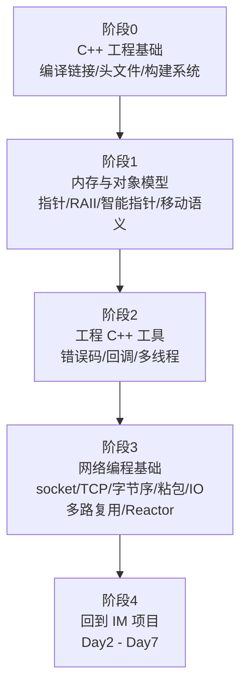

# myIM 零基础进阶路线（LEARNING PATH）

> 这份文件是学习路线的权威文档。**新会话恢复上下文时，读这份 + `docs/ROADMAP.md` 即可**。
> `docs/ROADMAP.md` 是 IM 项目的需求规格；本文件是"从算法竞赛 C++ 到能自己写出这个 IM"的教学阶梯。

---

## 0. 起点与目标

**起点（2026-10-09 确认）**
- C++ 只写过单文件算法题，熟悉 STL（`vector` / `map` / `sort` / DP 那一套）
- 没写过多文件工程，不了解编译链接过程
- 完全没碰过 socket / 网络编程 / 多线程 / 构建系统

**目标**
- 能独立理解并写出 `docs/ROADMAP.md` 里描述的那个 IM 项目
- 能在面试里讲清楚：TCP 分包、Reactor、Session 生命周期、心跳与半开连接

**教学方式（已约定）**
- 所有代码由**你自己手写**，一行一行敲
- 我只负责：讲原理、讲该怎么写、讲每样东西是干什么用的、review 你的代码
- 每天结束时当天代码必须能编译

---

## 1. 路线总览



**为什么必须按这个顺序**：阶段 3 的每一行代码都建立在阶段 0-2 之上。跳过阶段 1 直接学 Asio，结果就是"照着抄能跑，改一行就崩，报错完全看不懂"——这正是绝大多数人学不会网络编程的原因。

---

## 2. 阶段 0：C++ 工程基础

| 课 | 主题 | 必须理解的核心问题 |
|---|---|---|
| 0.1 | 从源码到可执行文件 | 预处理/编译/汇编/链接四步各干什么；**声明 vs 定义**；`LNK2019` 和 `LNK2005` 的成因 |
| 0.2 | 头文件与源文件 | `#include` 就是复制粘贴；为什么头文件里只能放声明；`#pragma once` 与 include guard |
| 0.3 | 符号、ODR、`inline`、`static` | 为什么头文件里的函数要 `inline`；内部链接 vs 外部链接 |
| 0.4 | 命名空间 | 为什么要 `namespace im`
| 0.5 | 构建系统 | 为什么需要 CMake；编译单元几千个时手工敲 `cl` 不现实 |

**验收**：能手工用 `cl` 分别编译两个 `.cpp` 再链接成一个 `.exe`，并能解释每一步产物是什么。

---

## 3. 阶段 1：内存与对象模型

| 课 | 主题 | 必须理解的核心问题 |
|---|---|---|
| 1.1 | 栈 vs 堆 | 栈帧、作用域、生命周期；为什么递归太深会爆栈 |
| 1.2 | 指针 vs 引用 | 两者的本质区别；悬垂指针 |
| 1.3 | `new`/`delete` 与 RAII | 构造函数申请、析构函数释放；为什么这才是 C++ 的核心思想 |
| 1.4 | 智能指针 | `unique_ptr` / `shared_ptr` / `weak_ptr`；**引用计数怎么工作** |
| 1.5 | 移动语义 | `std::move`、右值引用、为什么能把拷贝变成"偷指针" |
| 1.6 | 拷贝控制 | 拷贝构造/拷贝赋值/析构三件套；`=delete` |

**为什么阶段 1 是 IM 项目的命脉**：整个服务端的 Session 管理就一句 —— `std::shared_ptr<Session>` + `enable_shared_from_this`。不懂引用计数，Day2 的异步回调你写不出来，也解释不了为什么不会崩。

**验收**：能说清"为什么异步回调里必须捕获 `shared_from_this()` 而不是 `this`"。

---

## 4. 阶段 2：工程 C++ 工具

| 课 | 主题 | 必须理解的核心问题 |
|---|---|---|
| 2.1 | 错误处理 | 错误码 vs 异常；为什么 Asio 默认用错误码 |
| 2.2 | 回调与 lambda | 函数对象、捕获列表、`std::function` 的类型擦除 |
| 2.3 | 多线程 | `std::thread`、`mutex`、`lock_guard`、数据竞争；为什么共享 map 必须加锁 |
| 2.4 | 时间 | `steady_clock` vs `system_clock`；心跳超时怎么算 |

**验收**：能写一个两线程程序，理解不加锁为什么会出错。

---

## 5. 阶段 3：网络编程基础

| 课 | 主题 | 必须理解的核心问题 |
|---|---|---|
| 3.1 | 两台机器怎么通信 | IP / 端口 / TCP vs UDP / 三次握手为什么需要 |
| 3.2 | socket 是什么 | 操作系统给进程的通信抽象；文件描述符/SOCKET 句柄 |
| 3.3 | 阻塞式 TCP 服务器 | `socket` / `bind` / `listen` / `accept` / `recv` / `send` 六个调用 |
| 3.4 | **手写阻塞式 echo 服务器** | 裸 socket，不用 Asio，亲手跑通一次收发 |
| 3.5 | 字节序与协议设计 | 大端/小端；为什么要有长度头 |
| 3.6 | 粘包与拆包 | TCP 是字节流不是消息流；缓冲区的读偏移设计 |
| 3.7 | 阻塞模型的瓶颈 | 一连接一线程的问题；`select` / `poll` / `epoll` / IOCP 要解决什么 |
| 3.8 | Reactor 模式 | 事件循环 + 回调；`io_context` 到底是什么 |
| 3.9 | Asio 映射 | 把 3.3-3.8 学到的东西逐个对应到 Asio 的 API |

**验收**：能自己写出一个单线程处理多个连接的 echo 服务器，并解释它和阻塞版的区别。

---

## 6. 阶段 4：回到 IM 项目

回到 `docs/ROADMAP.md` 的 Day2-Day7。此时你会发现原来"看不懂"的那些代码，都是阶段 0-3 的直接应用。

| Day | 主题 | 用到的前置阶段 |
|---|---|---|
| Day2 | Buffer + Session + Server | 阶段 0（拆分文件）、1（shared_ptr）、2（回调）、3（Reactor） |
| Day3 | DB + UserManager + 登录 | 阶段 1、2（锁） |
| Day4 | 私聊转发 + 心跳 | 阶段 2（多线程/时间）、3（半开连接） |
| Day5 | 客户端网络层 | 阶段 3 |
| Day6 | Qt UI 绑定 | 阶段 2（跨线程信号槽） |
| Day7 | 联调收尾 | 全部 |

---

## 7. 【进度封存】2026-10-09

**环境：已完成，可直接使用**
- vcpkg 已装在 `E:\vcpkg`，`VCPKG_ROOT` 已设为用户级环境变量
- 依赖已装好到 `E:\myIM\vcpkg_installed\x64-windows\`：
  asio 1.32.0 / protobuf 6.33.4 / spdlog 1.17.0 / sqlite3 3.53.4（+ abseil、utf8-range、fmt）
- 工具链：CMake 4.4.0、VS2026 的 MSVC 14.51、生成器用 `Visual Studio 18 2026`
- 进 MSVC 环境的一条命令见第 8 节

**已存在的文件**（`docs/ROADMAP.md` 第 2 节的目录结构已基本落地）
- 工程骨架：`CMakeLists.txt`、`CMakePresets.json`、`vcpkg.json`、`.gitignore`、`.vscode/settings.json`
- 协议与共用层：`proto/im_msg.proto`、`common/include/im/common/tool.hpp`、`msg_type.hpp`、`common/src/tool.cpp`
- 服务端/客户端占位：`im_server/src/main.cpp`、`im_client/src/main.cpp`
- 验收程序：`tests/day1_proto_smoke.cpp`

**已讲授但尚未由你手写的课**
- 第 1 课 `proto/im_msg.proto`（协议字段、tag、wire type）
- 第 2 课 `common/include/im/common/msg_type.hpp`（enum class、ODR、`/W4`）
- 第 3 课 `common/include/im/common/tool.hpp`（大端位移、组帧、`unsigned char` 遍历坑）
- 第 4 课 `common/src/tool.cpp`（声明与定义分离）
- 第 5 课 顶层 `CMakeLists.txt`（CONFIG 模式、`protobuf_generate`、`PUBLIC/PRIVATE/INTERFACE`）
- 第 6 课 三个子目录 `CMakeLists.txt`（依赖传播）

**未完成**
- `tests/day1_proto_smoke.cpp`、两个 `main.cpp` 的逐行讲解
- Day1 验收（`cmake --preset default` → build → `day1_proto_smoke.exe` 输出 PASSED）
- Day2 之后全部

**当前状态：IM 项目暂停**，先走阶段 0-3 的基础教学。上面这些课的内容不会作废，阶段 0 讲完你会完全看懂它们。

---

## 8. 常用命令速查

```powershell
# 进入 MSVC 编译环境（每开一个新终端都要执行一次）
cmd /c "`"E:\vs2026\vs2026software\VC\Auxiliary\Build\vcvars64.bat`" >nul 2>&1 && set" | ForEach-Object { if ($_ -match '^([^=]+)=(.*)$') { Set-Item -Path "env:$($matches[1])" -Value $matches[2] } }

# 单文件编译 + 链接成 exe
cl /EHsc /std:c++17 /utf-8 main.cpp

# 只编译不链接（生成 .obj）
cl /c /EHsc /std:c++17 /utf-8 main.cpp

# 只看预处理结果（生成 main.i）
cl /P /EHsc /std:c++17 /utf-8 main.cpp

# 手工链接多个 obj
link main.obj math.obj /OUT:app.exe

# vcpkg 绝对路径（新终端里 PATH 可能没有）
E:\vcpkg\vcpkg.exe

# CMake 配置与构建（IM 项目）
cmake --preset default
cmake --build --preset relwithdebinfo
```

**注意**：`E:\vs2026` 是 VS2026 预览版目录，`C:\Program Files\Microsoft Visual Studio\2022\Community` 是 VS2022。
vcpkg 用的是 **VS2026 的 MSVC 14.51**，所以 CMake 生成器必须用 `Visual Studio 18 2026`，不能用 VS2022，否则链接期 `LNK2038`。
